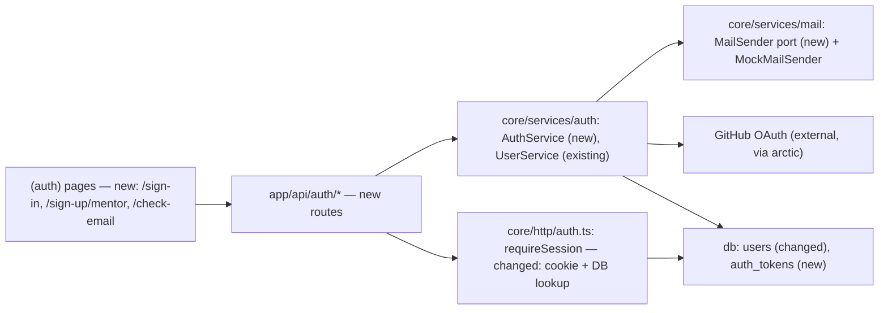
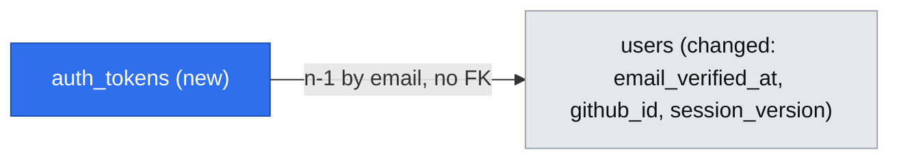

# Spec: Accounts and roles — real sign-up, sign-in and sessions for mentors and mentees (E01)

**Issue:** #20 (epic) · stories #26 (E01-S01, mentor) and #27 (E01-S02, mentee)
**Design authority:** `.ai/specs/product-brief.md` (branch `docs/lesson-04-discovery`) — R07, R13, D11, D12, A07
**Status:** ✅ implemented — Phases 1–4 in `develop` (Phase 4 via PR #54, merge commit `8cd9b9d`, 2026-10-26); spec moved to `implemented/` on 2026-10-26. Review gap: the Codex verdict on PR #54 was for `833a217`; the final head `ae3bb72` was not re-reviewed (recorded in the run log).

## 📝 TLDR

Today nobody can have an account: `requireSession` admits only a local dev admin and `users` rows are created
by an admin over `POST /api/users`. **Proposed (future behaviour):** people sign in **without passwords** —
with **GitHub** or a **one-time e-mail link** — and both methods prove the e-mail address at sign-up. A mentor
signs up from `/sign-up/mentor` and lands on profile setup with no payout step (R07); a mentee who picks a slot
is sent through sign-in and comes back to the same page with a verified account (R13, D12). A signed httpOnly
cookie session replaces the dev-admin shortcut everywhere except local development. Every Now story
(profile, slots, booking, payment, session) needs a known user; R13 needs a verified recipient for refunds.

## 📝 Problem Statement

- **No real users can exist.** `packages/core/src/http/auth.ts` returns `DEV_ADMIN_SESSION` only when
  `ALLOW_DEV_ADMIN=1` and `NODE_ENV=development`; every other caller gets 401. AGENTS.md: "Never deploy
  `/admin` or `/api/users` before the auth spec" — this is that spec.
- **Mentors leave when asked for money details too early:** "jak chcecie mój numer konta, zanim ktokolwiek mnie
  zabookował, to nie" `[INTERVIEW]` research/2026-09-03-interview-senior-python-meetups.md → R07.
- **Refunds, declines and the session need a known mentee:** R13 / D12 (Jan, against the agent's
  recommendation). **A07 is high-importance and untested:** one developer named account set-up and e-mail
  verification as a reason to leave ("jak booking trwa więcej niż pięć minut to robię rollback",
  research/2026-09-01-interview-backend-dev-fintech.md). The design therefore minimises the steps verification
  costs instead of adding a separate verification step.

## 📝 Proposed Solution

### Answers that shape it (gate, Jan, 2026-10-18)

| Q | Answer |
|---|---|
| Q1 split | one spec, phases: foundation, GitHub, mentor (S01), mentee (S02) |
| Q2 method | **GitHub OAuth + one-time e-mail link**; no passwords |
| Q3 e-mail | `MailSender` port in `core` + mock adapter now; a provider is chosen in its own spec before release |
| Q4 mentor verification | mentors verify too, without a step before profile setup |
| Q5 roles | one role per account (no change to `Session.role`) |
| Q6 who may mentor | open mentor sign-up; invitations are just links to it |
| Q7 admins | normal sign-in, promoted by a CLI command; dev-admin flag stays for local development only |

**Q2 resolves Q4 without a separate step:** a GitHub account is accepted only with a verified primary e-mail,
and an e-mail link proves the address when clicked. So **every self-created account is verified at
creation**; a mentor reaches profile setup right after the GitHub redirect or the link click. `emailVerifiedAt`
stays a column and a guard (`requireVerified`) for accounts created another way (admin `POST /api/users`).

### Flows

1. **E-mail link.** `/sign-in` (or `/sign-up/mentor`) → enter e-mail → server stores a hashed single-use token
   (15 min) with the intended role and the return path, commits, **then** sends the link → the page always says
   "Check your inbox" (no account enumeration) → the link opens **`/auth/confirm`**, a page that shows "Sign in as
   <e-mail>?" and a button; only the button's `POST` (CSRF header) consumes the token: find-or-create the user
   by e-mail, set `emailVerifiedAt`, start a session, redirect to the return path. A GET never consumes a token,
   so mail scanners that prefetch links (Outlook Safe Links, Gmail) cannot burn it, and a link sent by someone
   else cannot silently sign the reader in to a foreign account (login CSRF): the page names the account.
2. **GitHub.** "Continue with GitHub" → `GET /api/auth/github/start` (state + PKCE cookie, intended role and
   return path in the signed state, both validated by the same Zod schema as flow 1) → GitHub →
   `GET /api/auth/github/callback` → read the primary e-mail (lower-cased); if it is not verified, refuse with a
   message → find user by `githubId`, else by e-mail (link the GitHub id only because GitHub verified that
   e-mail), else create → session → redirect. GitHub is reached through a **`GitHubClient` port** (real adapter on
   `arctic`, fake adapter for tests), chosen like the mail adapter.
3. **Existing account.** Signing up as a mentor with an e-mail that already has an account signs the person in
   to **that** account, shows "An account with this e-mail already exists — you are signed in to it; its role
   was not changed", and creates nothing. This is how S01's negative criterion ("refused with a message, no
   second account") is met without the sign-up form revealing which e-mails are registered (engineering
   standards: "never revealing whether a given email is registered"). ⚠ AC wording interpretation — see Risks.
4. **Return path.** `next` must be a same-origin relative path (`/` + no `//`, no `\`, max 512); otherwise the
   role's default (`/mentor/profile` for mentors, `/` for mentees). It survives both flows.
5. **Session.** JWT (HS256, `jose`) in cookie `mh_session` — httpOnly, `secure` in production, `sameSite=lax`,
   `path=/`, **7 days fixed, no refresh and no sliding window** (grill-me Q6/Q13: an explicit deviation from the standards' 24 h example — a mentee who books today must still reach tomorrow's session without signing in again; `httpOnly` + `secure` + `sameSite` + “sign out everywhere” bound the exposure). Claims: `sub`, `sv` (session version). Each
   request loads the user and rejects the token when `sv` differs. **Sign out** clears this device's cookie only;
   **"Sign out everywhere"** and a **role change** bump `sessionVersion`, which ends every other session.
   `Session` gains one field, `emailVerified: boolean` (additive; `DEV_ADMIN_SESSION` has `true`).

### Alternatives considered

- **Passwords (bcrypt + reset)** — the standards' default; rejected by Q2: reset flow, attempt limits and one
  extra verification step, all against A07.
- **Auth.js / Better Auth** — mature, but neither ships a MikroORM adapter (custom adapter or a second ORM's
  tables), and Auth.js warns against linking accounts by e-mail; our need is one provider + one link flow.
- **Hosted (Clerk, Auth0)** — fastest, but users' PII and sessions leave our database and the cookie/CSRF
  contract in BACKWARD_COMPATIBILITY §7 would be theirs.
- **Chosen:** in-house session on `jose` (JWT) + `arctic` (GitHub OAuth client; state/PKCE handled) — two small
  dependencies, everything else on existing primitives.

## 📝 Research — what market leaders do (and what we skip)

| Practice (Auth.js, Better Auth, Supabase Auth, Clerk, Lucia guide) | Here |
|---|---|
| Magic-link tokens are random, stored **hashed**, single-use, short-lived | adopted: SHA-256 hash, 15 min, `usedAt` |
| OAuth with `state` (+ PKCE) to stop CSRF on the callback | adopted via `arctic` |
| Link accounts by e-mail only when the provider verified it | adopted: GitHub primary + verified only |
| Revocable sessions (DB session or token version) | adopted: `sessionVersion` |
| Rate limits on sign-in requests | adopted: per e-mail and per IP, counted on `auth_tokens` |
| 2FA, passkeys, refresh tokens, account-linking UI, social providers beyond one | **skipped** for the first release |

## 📝 Architecture

One `auth` concept across the layers; no new package, no new pattern.

Takeaway: the only cross-cutting change is `requireSession` becoming **async** (it reads the cookie and loads
the user through a narrow `SessionUserLookup` resolved from the request's container scope, injectable in tests).
Its three call sites change in Phase 1. **`makeCrudRoute` must `await` it:** today `authorize` is typed
`(request) => unknown` and called without `await` (`packages/core/src/http/makeCrudRoute.ts:52`), so an async
`requireSession` would reject unhandled and the route would run unauthenticated — TypeScript does not catch it.
`authorize` becomes `(request) => Promise<Session | void>` and is awaited, with a mutation test. `Session` keeps
`userId`, `role`, `isDevSession` and gains `emailVerified` (additive).

- `AuthService` (request-scoped, registered in `container.ts` / `cradle.ts`): `requestEmailLink`,
  `consumeEmailLink`, `signInWithGitHub`, `startSession`, `signOutEverywhere`. Throws `AppError`s only.
- `MailSender` port: `send({ to, subject, text })`. `MockMailSender` logs a redacted line and appends the
  message to `MAIL_OUTBOX_FILE` when set (integration tests read the link from it). No HTTP route exposes mail.
- Events: `auth.user.created` gains `method: 'email' | 'github' | 'admin'` (EventMap, compile-checked;
  `UserService.create` emits `admin`; BACKWARD_COMPATIBILITY §3 updated); no new event — A07 counting is E05's
  (data: `auth_tokens` requested vs used, `users.createdAt`; rows are kept, see Data Model).
- Verification helper next to `requireRole`: `requireVerified(session)` (403 `email_unverified`), reading
  `session.emailVerified`; consumed by E03 booking routes. (An ownership helper belongs to E03, which has the
  first owned record.)
- Role CLI: `packages/db/src/scripts/set-role.ts` + `make set-role EMAIL=… ROLE=…` (sets the role, bumps
  `sessionVersion`); promoting the first admin and turning a mentee into a mentor both go through it (grill-me Q10).
  bumps `sessionVersion`).

## 📝 Data Model

**`users` (changed, additive migration):**

| Column | Type | Notes |
|---|---|---|
| `name` | `varchar(120) null` (was `not null`) | an e-mail-link account has no name at creation; the mentor gives it in profile setup (E02-S01), the mentee at the first booking (E03-S01) — grill-me Q5/Q12 |
| `email_verified_at` | `timestamptz null` | set by link click or verified GitHub e-mail; admin-created rows stay `null` |
| `github_id` | `varchar(32) null unique` | GitHub numeric id as text |
| `session_version` | `int not null default 0` | bumped on sign-out-everywhere and role change |

**`auth_tokens` (new):**

| Column | Type | Notes |
|---|---|---|
| `id`, `created_at`, `updated_at` | base properties | UUID |
| `email` | `varchar(320)` | lower-cased; no FK (the user may not exist yet) |
| `token_hash` | `char(64) unique` | SHA-256 of a 32-byte random token; the raw token exists only in the e-mail |
| `intent_role` | `enum('mentee','mentor') null` | role for a **new** account; never changes an existing one |
| `next_path` | `varchar(512) null` | validated return path |
| `ip_hash` | `char(64)` | SHA-256(IP + `AUTH_SECRET`) for rate limiting; no raw IP stored |
| `expires_at`, `used_at` | `timestamptz`, `timestamptz null` | single use |

Sensitive data: e-mail and GitHub id are personal data; raw tokens and IPs are never stored. `token`, `cookie`
and `email` are already in the logger's `REDACTED_PATHS`; add the JWT and OAuth state cookie names. Retention:
token rows are kept **30 days** (enough for the first A07 read; they hold e-mails of people who may never sign up — grill-me Q9), then deleted opportunistically by any request that creates a
token — bounded, no job (there is no worker in this project).

## 📝 API Contracts

All routes under `packages/app/src/app/api/auth/`, built with `apiHandler`; bodies parsed by Zod schemas in
`core/validators/auth/`. Redirect routes return a `Response` (escape hatch already allowed by `apiHandler`).

| Route | In | Out |
|---|---|---|
| `POST /api/auth/email/start` (CSRF header) | `{ email, intentRole?: 'mentor', next? }` | `200 { ok: true, data: { sent: true } }` — **always**, also for unknown or existing e-mails; `422` invalid; `429` rate limit; `503` mail not sent |
| page `GET /auth/confirm?token=` | token | renders "Sign in as <e-mail>?" — **consumes nothing**; unknown/expired token → "This link has expired…" |
| `POST /api/auth/email/consume` (CSRF header) | `{ token }` | `200 { next }` + session cookie; invalid/expired/used → `410 link_invalid` |
| `GET /api/auth/github/start?role=mentor&next=` | | `302` to GitHub; `role` and `next` parsed by the shared schema (`role=admin` → `/sign-in?error=invalid_request`); state + PKCE in a short-lived httpOnly cookie |
| `GET /api/auth/github/callback` | `code`, `state` | `303` to `next`; bad state → `/sign-in?error=github_failed`; no verified e-mail → `/sign-in?error=github_email_unverified` |
| `POST /api/auth/sign-out` (CSRF header) | `{ everywhere?: boolean }` | `200`, cookie cleared; `everywhere: true` also bumps `sessionVersion` |
| `GET /api/auth/me` | session | `200 { id, email, name, role, emailVerified }`; `401` without session |

Rate limits live in a separate `AUTH_LIMITS` constant next to `RULES` (security parameters, not business ones;
BACKWARD_COMPATIBILITY §4 reserves `RULES` for the latter), each value with its reason: max 3 links per e-mail
per 15 min (a person retrying, not a script), max 20 per IP-hash per hour (a shared office NAT) →
`429 rate_limited`, generic message. The count and the insert run in one transaction under a
transaction-level advisory lock keyed by the e-mail (bound parameter, no string-built SQL), so concurrent
requests cannot both pass the limit.

Env (Zod, `env.ts`; BACKWARD_COMPATIBILITY §5 — `.env.example` and `docker-compose.yml` updated in the same PR):
- `AUTH_SECRET` — ≥ 32 bytes, **required in every environment except `test`** (which gets a fixed test-only
  default, so CI needs no new secret). No development default: `env.ts` defaults `NODE_ENV` to `development`,
  so a dev default would sign production JWTs with a known secret if `NODE_ENV` were forgotten. `make setup`
  generates a random value for local development when missing.
- `APP_URL`; `MAIL_ADAPTER` (`mock`; **rejected when `NODE_ENV=production`** unless
  `ALLOW_TEST_ADAPTERS=1`, which only the integration suite sets); `MAIL_OUTBOX_FILE` (optional);
  `GITHUB_ADAPTER` (`real` | `fake`, same production rule); `GITHUB_CLIENT_ID`, `GITHUB_CLIENT_SECRET`
  (required with `real`; without them the GitHub button is hidden).

## 📝 UI/UX

Product UI text in English; public pages Tailwind (`(auth)` route group); screens reuse discovery ids where
they exist.

- **`/sign-in`** — "Continue with GitHub" + e-mail field + "Send me a sign-in link"; carries `next`. Copy under
  the form: "No password. We'll e-mail you a link that signs you in." Errors from `?error=` as an alert.
- **`/sign-up/mentor`** — same two methods with mentor copy ("Set up your mentor profile — no bank details
  needed until someone books you"); sends `intentRole: 'mentor'`.
- **`/check-email`** — "Check your inbox at …" (the address the person typed), resend after 60 s.
- **`/mentor/profile`** (`(mentor)` group) — placeholder **profile setup** page, mentor role required; heading,
  name and the notice from flow 3 when present; **no payout field or step** (R07). E02-S01 fills the page.
- Mentee path: any future "book" button links to `/sign-in?next=<current page with slot>`; after sign-in the
  person lands on that exact URL (S02).
- Signed-in header: name + "Sign out" (POST via `apiCall`).
- Accessibility: labelled inputs, error alerts with `role="alert"`, focus moves to the alert.

## 📝 Edge Cases & Failure Scenarios

| Case | What the user sees |
|---|---|
| Link clicked twice / after 15 min | confirm page: "This link has expired or was already used — send a new one." |
| Mail scanner prefetches the link | nothing happens — GET only renders the confirm page; the person's own click still works |
| Link opened on another device | works (token is not bound to the browser); session starts on that device |
| GitHub account without a verified e-mail | "Your GitHub e-mail isn't verified — verify it on GitHub or use an e-mail link." |
| GitHub denied / state mismatch | "GitHub sign-in didn't complete — try again." |
| Existing mentee signs up as mentor (Q5) | signed in to the mentee account, notice "its role was not changed" |
| Same e-mail via GitHub and via link | one account (GitHub id linked to it because GitHub verified the e-mail) |
| Someone requests links for another person's e-mail | they get nothing; the owner gets an e-mail they can ignore; rate limits cap it |
| Mail adapter throws | the token is already committed; it is marked dead and the user sees "We couldn't send the e-mail — try again" (`503`); no usable token without a sent e-mail |
| Commit fails | nothing is sent (send happens only after commit) |
| GitHub API down or slow | callback times out (10 s) → "GitHub sign-in didn't complete — try again." |
| DB error while loading the session user | `401` — fail closed |
| `AUTH_SECRET` missing (any env but `test`) | server refuses to start (env validation) — fail closed |
| `role=admin` or unknown role in a sign-up request | rejected by the schema; never creates an admin |
| Role changed or "sign out everywhere" | old cookies stop working on the next request (`sv` mismatch → 401) |
| Unverified (admin-created) account tries a guarded action | `403 email_unverified`; signing in by link verifies it |
| `next` is an absolute URL or `//evil.com` | ignored; role default used (no open redirect) |

## 📝 Risks & Impact Review

- **Breaking internal API:** `requireSession` becomes async; three call sites change in the same PR
  (BACKWARD_COMPATIBILITY §7 "Session, roles and CSRF"). The session cookie name `mh_session` becomes a
  protected surface — add it to §7 in the same PR. `risk-high`, second reviewer.
- **Schema:** additive migration (nullable columns, one default, one new table) — reversible `down`.
  Rehearse up → down → up with rows (lessons 2026-10-18). **Rollback loses data:** `down` drops
  `email_verified_at` and `github_id`, so after a later `up` every account is unverified and GitHub links are
  gone (people re-verify by signing in once). Roll back only before real users exist, or keep the columns.
- **Security:** fail closed everywhere; dev-admin allowlist unchanged (loosening it is a defect, §7). No raw
  token, IP, cookie or JWT in logs (pino redaction paths added and tested).
- **Second reviewer for `risk-high` (grill-me Q4/Q14):** `develop` requires 0 approvals and GitHub rejects self-approval, so the SDLC “second person” is defined as an `om-code-review` run in **Codex** (a different model than the author) whose verdict is posted on the PR with the model named; a `risk-high` PR merges only with that comment. One sentence goes into `SDLC.md` › Review loop in the Phase 1 PR.
- **Product interpretation (settled, grill-me Q1):** S01's negative AC "sign-up is refused with a message and no second
  account exists" is met by signing the person in to the existing account with a notice, because a form-level
  "e-mail already in use" message would reveal registered e-mails. Jan chose this reading; #26 AC3 was reworded accordingly.
- **Scope move (settled, grill-me Q2):** S02 AC3 ("another person opening a mentee's bookings is refused") cannot be
  tested before bookings exist; it moved, with the ownership helper, to E03-S01 (#32).
- **A07 stays untested.** The design removes the separate verification step, but a mentee still leaves the
  mentor's page to sign in. Measurement belongs to E05; the data exists from Phase 1.
- **What works when deployed:** Phase 1 alone works only locally and in tests (the mock mail adapter is
  refused in production). A deployed environment gets its first sign-in from **Phase 2 (GitHub)**; the first
  admin is a GitHub account promoted with the CLI. E-mail links in production need the mail-provider spec (Q3);
  release also needs Q05 (terms and data processing) from the brief.
- **Integration suite changes:** `tests/integration/global-setup.ts` starts `next dev` and `next start` on
  different ports with one shared env; each server now gets its own `APP_URL`, `MAIL_OUTBOX_FILE`, a test
  `AUTH_SECRET`, `ALLOW_TEST_ADAPTERS=1` and `GITHUB_ADAPTER=fake` (no real GitHub in CI; no change to
  `.github/workflows/`, a protected path).
- **Dependencies:** `jose`, `arctic` (both small, no transitive heavyweights); `make audit` must stay green.

## 📝 Decisions in play

| Id | How this spec relies on it | Owner |
|---|---|---|
| R07 / D11 | no payout field or step in mentor onboarding (Phase 3) | Jan |
| R13 / D12 | account verified before booking: every self-created account is verified at creation; `requireVerified` guards booking routes (E03) | Jan |
| A07 | not superseded; the passwordless design is the mitigation, measured in E05 | Jan |
| N01, N02 | untouched | founder A |
| D14 (pending `om-discover --refresh`) | open mentor sign-up; invitations are links to `/sign-up/mentor` (gate Q6, grill-me Q7) | Jan |
| 25-hour build limit from the founders' workshop | **not binding** for this repository (grill-me Q8); the course calendar (13.11) is; “Stripe only” and “no video” stay for their own reasons | Jan |

No rule, non-goal or decision is superseded.

## 📋 Phasing

| Phase | Ships | Independently usable? |
|---|---|---|
| 1 — Foundation + e-mail link | session cookie, async `requireSession` (+ awaited in `makeCrudRoute`), `auth_tokens`, mail port + mock, `/sign-in`, `/check-email`, `/auth/confirm`, sign-out, `me`, rate limits, admin CLI | yes, locally and in tests: anyone can sign in by link (as mentee by default) |
| 2 — GitHub sign-in | `GitHubClient` port (`arctic` + fake), start/callback routes, account linking by verified e-mail | yes, also deployed: first real sign-in and first admin |
| 3 — Mentor sign-up (E01-S01, #26) | `/sign-up/mentor`, `intentRole`, `/mentor/profile` placeholder, existing-account notice | yes |
| 4 — Mentee return-to-slot (E01-S02, #27) | `next` end-to-end in both methods, `requireVerified` | yes; booking routes (E03) consume the guard |

Each phase is one PR, labelled `risk-high`, with `run-integration`. **Delivery order: 1 → 3 → 2 → 4** (grill-me Q3): #26 is the second PR; Phase 3 needs nothing from GitHub, and GitHub is needed only for the first sign-in on a deployed environment. Until a mail-provider spec lands, a deployed environment is GitHub-only, which Jan accepted for the first mentors (grill-me Q11).

## 📋 Implementation Plan

### Phase 1 — Foundation and e-mail link

1. **Env + limits.** Add `AUTH_SECRET`, `APP_URL`, `MAIL_ADAPTER`, `MAIL_OUTBOX_FILE`, `ALLOW_TEST_ADAPTERS` to
   `env.ts`, `AUTH_LIMITS` next to `RULES`; `.env.example`, `docker-compose.yml`, `make setup` (generates a local
   secret). *Test:* `parseEnv` rejects a missing or short secret in `development` and `production`, accepts the
   `test` default, rejects `MAIL_ADAPTER=mock` in production without `ALLOW_TEST_ADAPTERS=1`.
2. **Migration.** `users` columns (incl. `name` → nullable) + `auth_tokens` entity via `make db-migration NAME=auth-tokens`; review SQL.
   *Test:* migrator test up → down → up with rows; `make db-migration` reports no changes afterwards.
3. **Session primitives.** `core/http/session.ts`: sign/verify JWT (`jose`), cookie build/clear helpers.
   *Test:* tampered, expired and wrong-secret tokens are rejected; cookie flags per environment.
4. **Async `requireSession`.** Read cookie → verify → load user via `SessionUserLookup` (request scope) →
   compare `sv` → `Session` with `emailVerified`; dev-admin branch unchanged. Update `api/users`,
   `api/admin/health`; in `makeCrudRoute` retype `authorize` to `Promise<Session | void>` and `await` it.
   *Test:* existing denied-path tests still pass; valid cookie, `sv` mismatch, deleted user, DB error (→ 401,
   fail closed); **mutation:** removing the `await` in `makeCrudRoute` makes an unauthenticated `GET /api/users`
   test fail.
5. **Mail port.** `MailSender` interface, `MockMailSender`, container registration by `MAIL_ADAPTER`.
   *Test:* outbox file receives the message; log line contains no token.
6. **`AuthService` e-mail link.** `requestEmailLink` (advisory lock → rate-limit count → insert hashed token →
   commit → send; on send failure mark the token dead) and `consumeEmailLink` (single use, expiry,
   find-or-create, verify, emit `auth.user.created` with `method`). *Test:* each Edge Cases row for links;
   concurrent requests do not exceed the limit; mutation: removing the `usedAt` check fails a test.
7. **Routes + pages.** `email/start`, `email/consume`, `sign-out` (`everywhere`), `me`; `/sign-in`,
   `/check-email`, `/auth/confirm` (GET renders only); header sign-out. *Test:* route tests (422, 429, 410,
   503, 200 always, CSRF 403); a GET of `/auth/confirm` leaves the token unused; Testing Library for pages.
8. **Role CLI.** `set-role` script (`make set-role EMAIL=… ROLE=admin|mentor|mentee`; bumps `sessionVersion`) — also the only way in 1.0 for a mentee to become a mentor (grill-me Q10; self-service role change is parked in E06). *Test:* script logic in a tested module.
9. **Docs/contracts + integration harness.** `SDLC.md` › Review loop: the Codex second-reviewer sentence (Q14). AGENTS.md "No real auth yet" bullet replaced; BACKWARD_COMPATIBILITY
   §1 (routes), §3 (event payload), §5 (env), §7 (cookie `mh_session`, `Session.emailVerified`); redaction paths
   for the JWT and state cookies; per-server env in `tests/integration/global-setup.ts`. **Integration:** sign in
   by link (outbox file, confirm button), `/api/auth/me` returns the user, sign-out invalidates the cookie, admin
   `/api/users` denied for a mentee session.

### Phase 2 — GitHub sign-in

1. Env `GITHUB_CLIENT_ID/SECRET`; feature disabled (button hidden) when absent. *Test:* env + page render.
2. `GitHubClient` port: real adapter on `arctic` (state + PKCE, 10 s timeout), fake adapter for tests;
   `github/start` + `github/callback`. *Test:* state mismatch, denied consent, timeout, `role=admin` rejected.
3. `signInWithGitHub`: primary verified e-mail only, lower-cased; link by `githubId`, then by e-mail; create
   otherwise. *Test:* unverified e-mail refused; linking does not create a duplicate. **Integration:** with
   `GITHUB_ADAPTER=fake` (no real GitHub in CI).

### Phase 3 — Mentor sign-up (E01-S01, #26)

1. `/sign-up/mentor` page sending `intentRole: 'mentor'` (link) / `role=mentor` (GitHub).
   *Test:* AC1 — new account lands on `/mentor/profile` with role `mentor`.
2. `/mentor/profile` placeholder, mentor role required (others → 403 page / redirect to `/sign-in`).
   *Test:* AC2 — no payout/bank field or step in the rendered onboarding (assert by text and form fields).
3. Existing-account notice. *Test:* AC3 (reworded in #26) — sign-up with a used e-mail: same user id, role unchanged, notice shown,
   `users` count unchanged. **Integration:** the three ACs end to end.

### Phase 4 — Mentee return-to-slot (E01-S02, #27)

1. `next` validation helper and plumbing through both flows. *Test:* open-redirect cases rejected.
2. `requireVerified`. *Test:* AC2 — an unverified session (admin-created account) gets `403 email_unverified`;
   the guard is consumed by E03 booking routes. AC3 (another person opening a mentee's bookings) needs the first
   owned record and is **moved to E03-S01** with the ownership helper.
3. **Integration:** a visitor opens a page with `?slot=` → sign-in → link from the outbox → back on the exact
   URL with a verified session (AC1).

### Progress

| Phase | Status | Evidence |
|---|---|---|
| 1 Foundation + e-mail link | ✅ done | branch `feat/e01-phase1-auth-foundation`, commits `b06fd68` (env + `AUTH_LIMITS`, `make setup` secret) · `875ca9e` (migration `Migration20261018191125_auth_tokens`, up → down → up with rows, generator reports no changes) · `485a7f9` (`jose` session, async `requireSession`, awaited `authorize` — mutation: without the `await` an unauthenticated GET answers 200, 2 tests red) · `816d443` (`MailSender` + mock outbox, `AuthService` — mutation: without the `usedAt` condition a link clicked twice signs in again, 1 test red) · `8d7f618` (routes, `(auth)` pages, `SessionMenu`, env validated at boot) · `5d58f28` (`make set-role`) · `98464d3` (contracts §1/§3/§5/§7, SDLC Codex second reviewer, redaction, integration). `make check` exit 0 (lint, typecheck, 300 unit tests at 100 %, build, audit); `make test-integration` 35/35 (sign in by link from the outbox, GET consumes nothing, me, sign-out + everywhere, mentee denied on `/api/users`, 410/429/422/403, migration 3). Run log: `.ai/runs/2026-10-18-e01-phase1-auth-foundation.md` |
| 2 GitHub sign-in | ✅ done | branch `feat/e01-phase2-github-sign-in` (stacked on Phase 3), commits `b1a93c7` (`fix(auth)`: Phase 3 AC1 test clock pinned — millisecond flake) · `1b845ba` (env: `GITHUB_ADAPTER`, `GITHUB_CLIENT_ID/SECRET`, `isGitHubEnabled`, limits, redaction) · `ff987ac` (`GitHubClient` port, `ArcticGitHubClient` with state + PKCE S256 and 10 s timeout, `FakeGitHubClient` on `GITHUB_FAKE_FILE`, `mh_github` state cookie, `signInWithGitHub`, `GitHubSignInService` — mutation: without the state comparison the test "state mismatch → github_failed" is red; without the verified-e-mail guard "refuses an unverified primary e-mail" is red: `promise resolved … instead of rejecting`) · `efa923d` (routes `github/{start,callback}`, "Continue with GitHub" on both pages, error copy) · `f356d4b` (integration: browser flow from `/sign-up/mentor`, unverified, denied, state tampering, link-by-e-mail without a duplicate, denied paths). `make check` exit 0 (lint, typecheck, unit tests at 100 % in every package, build, audit); `make test-integration` 53/53 twice (github-sign-in 6, auth 19, mentor-sign-up 6, migrations 7, app 15). Run log: `.ai/runs/2026-10-18-e01-phase2-github-sign-in.md` |
| 3 Mentor sign-up (#26) | ✅ done | branch `feat/e01-phase3-mentor-sign-up` (stacked on Phase 1), commits `9ef8db5` (core: role-aware landing, existing-account notice, `pageAccess` — mutation: applying `token.intentRole` to an existing user turns the AC3 test red) · `fad76aa` (`/sign-up/mentor`, `/mentor/profile` in `(mentor)`, `EmailLinkForm` shared, `ExistingAccountNotice`) · `119455d` (integration: AC1–AC3 end to end, no enumeration, denied paths) · `009157b` (AGENTS, BACKWARD_COMPATIBILITY §1, README) · `da11f23` (`fix(auth)`: a Phase 1 test flake — clock pinned). `make check` exit 0 (lint, typecheck, unit tests at 100 % in every package, build, audit); `make test-integration` 41/41 (mentor-sign-up 6, auth 13, migrations 7, app 15). Run log: `.ai/runs/2026-10-18-e01-phase3-mentor-sign-up.md` |
| 4 Mentee return-to-slot (#27) | ✅ done (PR #54, awaiting merge) | branch `feat/e01-phase4-mentee-return` (PR #54), commits `0b3eab2` (T1: validated `next` through both sign-in flows, open-redirect cases rejected) · `01eb1c5` (T2: `requireVerified` → `403 email_unverified`, AC2) · `7074962` (T3: integration AC1 — `?slot=` → sign-in → outbox link → exact URL with verified session; the `/mentor/profile` guard keeps the query) · `9cc078d` (`fix(ui)`: E01 auth screens on design tokens, `make lint-tokens` 45 → 0) · close-out `docs(specs): E01 phase 4 progress and run log` (last commit of the PR). `make check` exit 0; `make test-integration` 57/57 on two consecutive runs (2026-10-26). Run log: `.ai/runs/2026-10-26-e01-phase4-mentee-return.md` |

Phase 2 deviations from the text above, with reasons: `GITHUB_ADAPTER` unset means "GitHub off" (button hidden, routes answer `invalid_request`) rather than an invalid environment, so Phase 1/3 deployments and `make dev` keep booting; `real` without both credentials is invalid and both credentials alone imply `real` (step 1 names only the two ids). The real adapter uses arctic's generic `OAuth2Client` with `createAuthorizationURLWithPKCE`, not its `GitHub` provider class (no PKCE method there); the timeout is per outbound call (token, `/user`, `/user/emails`, 10 s each) because arctic exposes no abortable token request. `role` and `next` on `github/start` are validated by the shared schemas and an invalid `next` is refused (`invalid_request`) like `email/start` does (422), not silently replaced by the role default. Every callback failure — including a database error — is a `303 /sign-in?error=github_failed` (the reason in the log), never a JSON 500 on a browser navigation. `arctic@3.7.0` is marked deprecated on npm (no advisory; `make audit` green) — noted for the reviewer.

Phase 3 deviations from the text above, with reasons: step 1 ships the e-mail link only (`role=mentor` for GitHub comes with Phase 2's `github/start`, which does not exist yet); the "403 page" for another role is a refusal rendered by the page (Next.js server components cannot set a 403 status without the experimental `authInterrupts`; the refusal shows no profile content and the integration test asserts it), while a signed-out visitor gets a real `307` to `/sign-in?next=/mentor/profile`; the notice travels as a validated query parameter (`?notice=existing_account`) on the landing path rather than a flash cookie — no new cookie contract in §7, no server state, and it disappears with the parameter (shown once).

Phase 1 deviations from the text above, with reasons: `docker-compose.yml` has no app service, so the new variables are documented there in a comment and in `.env.example`; a valid `mh_session` cookie takes precedence over the dev-admin flag (the allowlist itself is unchanged), so real sessions can be exercised on `make dev` and in the dev-server integration tests; `next` is validated by `nextPathSchema` already in Phase 1 (storing an unvalidated path would be an open redirect waiting for Phase 4) and `consume` returns it — the end-to-end return-to-slot flow stays in Phase 4.

## 📝 Grill-me outcome (2026-10-18, Jan)

| Q | Decision |
|---|---|
| Q1 | #26 AC3 reads: signed in to the existing account, notice that the role was unchanged, no second account (no e-mail enumeration) |
| Q2 | S02 AC3 (another person opening a mentee's bookings) moved to #32 with the ownership helper |
| Q3 | delivery order 1 → 3 → 2 → 4; #26 is the second PR |
| Q4 / Q14 | second reviewer for `risk-high` = `om-code-review` in Codex, verdict posted on the PR; rule added to `SDLC.md` |
| Q5 / Q12 | `users.name` nullable; required to publish a mentor profile (#28) and at the mentee's first booking (#32) |
| Q6 / Q13 | session 7 days fixed, no refresh, no sliding window — explicit deviation from the 24 h example |
| Q7 | open mentor sign-up to be recorded in the brief as D14 (`om-discover --refresh`) |
| Q8 | the founders' 25-hour build limit does not bind this repository |
| Q9 | `auth_tokens` retention 30 days |
| Q10 | mentee → mentor only via the `set-role` CLI in 1.0; self-service parked in E06 |
| Q11 | deployed environment GitHub-only until the mail-provider spec (after E02) |
| Q15 | spec PR before implementation, as with #18 |
