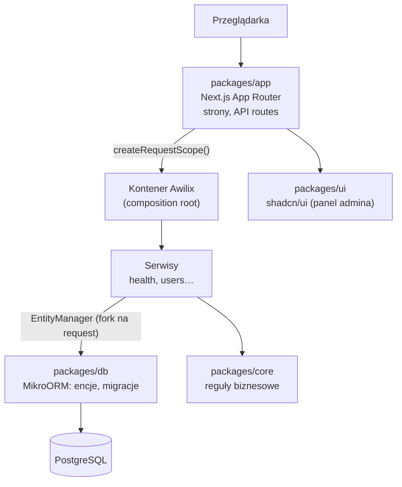

# MentorHub

Marketplace **mentoringu 1:1 przez wideo**: osoby rozwijające karierę w produkcie, inżynierii, AI i UX rezerwują sesje z praktykami, którzy „już to zrobili”. Projekt kursowy programu **AI Tech Leaders** (12.10–13.11.2026), prowadzony według AI-native SDLC.

> [!NOTE]
> **Status (2026-10-17):** discovery zakończone, [`intent.md`](docs/sdlc/intent.md) w wersji **draft** czeka na akceptację product ownera. Stack postawiony ([specyfikacja](.ai/specs/2026-10-17-stack-bootstrap.md)): monorepo pnpm z aplikacją Next.js, bazą PostgreSQL przez MikroORM, DI na Awilix, Tailwind i shadcn/ui. Funkcji produktu jeszcze nie ma — jest szkielet: strona publiczna, panel admina z listą użytkowników (**bez logowania, tylko lokalnie**) i `/api/health`.

## Od czego zacząć

| Chcę… | Otwórz |
|---|---|
| Zrozumieć produkt w 5 minut | [docs/discovery/README.md](docs/discovery/README.md) |
| Przeklikać prototyp | `docs/discovery/mockups/index.html` (dwuklik, bez serwera) |
| Zobaczyć, kto korzysta i po co | [01 · Użytkownicy i potrzeby](docs/discovery/01-Uzytkownicy-i-potrzeby.md) |
| Zobaczyć przepływy i reguły biznesowe | [02 · Use case'y i przepływy](docs/discovery/02-Use-case-i-przeplywy.md) |
| Zobaczyć ekrany | [03 · Mapa ekranów](docs/discovery/03-Mapa-ekranow-i-nawigacja.md), [04 · Specyfikacja ekranów](docs/discovery/04-Specyfikacja-ekranow.md) |
| Zobaczyć proponowane API | [05 · Katalog API](docs/discovery/05-Katalog-API.md) |
| Wiedzieć, jak pracujemy | [docs/sdlc/00-OVERVIEW.md](docs/sdlc/00-OVERVIEW.md) |

## Uruchomienie lokalne

Wymagane: Node ≥ 22 (`.nvmrc`: 26), pnpm 10, Docker.

```bash
make install        # zależności z lockfile
make db-up          # PostgreSQL 17 w Dockerze na porcie 5433
make db-migrate     # migracje
make dev            # http://localhost:3000  ·  /admin  ·  /api/health
make check          # to, co uruchamia CI: lint, typecheck, testy, build
```

Domyślne ustawienia bazy pasują do `docker-compose.yml`, więc plik `.env` nie jest potrzebny. Inne wartości (zob. `.env.example`) podaj w zmiennych środowiskowych powłoki albo w `packages/app/.env.local` dla aplikacji. Next.js czyta pliki `.env` z katalogu pakietu `app`, a skrypty migracji tylko ze środowiska.

## Architektura



| Pakiet | Odpowiada za | Zależy od |
|---|---|---|
| `packages/app` | aplikacja Next.js: trasy, strony, API, kontener DI, serwisy | core, db, ui |
| `packages/core` | logika wielokrotnego użytku bez frameworka: reguły i polityki biznesowe (`RULES`) | — |
| `packages/db` | konfiguracja MikroORM, encje, migracje, singleton ORM | — (dozwolone: core) |
| `packages/ui` | komponenty shadcn/ui i tokeny motywu (Tailwind 4) | — |

**Kluczowe decyzje**

- **Monorepo pnpm:** cały kod (aplikacja i biblioteki) w jednym repo, więc agent ma kod pakietów pod ręką. Pakiety wewnętrzne są konsumowane jako źródło TypeScript (`transpilePackages`).
- **Awilix:** jedyne miejsce, które dotyka singletona ORM, to `packages/app/src/server/container.ts`. Serwisy dostają zależności wstrzyknięte, a każdy request własny `EntityManager`.
- **MikroORM 7** z encjami przez `defineEntity` (bez dekoratorów, działa z buildem Next.js). Pula połączeń z `DATABASE_URL`, singleton trzymany na `globalThis`, żeby hot reload nie mnożył połączeń. ORM łączy się leniwie, więc health check wykonuje `select 1`.
- **Tailwind** na stronach publicznych, **shadcn/ui** (z `@mentorhub/ui`) w panelu admina.
- Parametry biznesowe tylko w `RULES` w `@mentorhub/core`; wartości z discovery są propozycją, dopóki nie przyjmie ich specyfikacja.

Reguły dla agentów: [AGENTS.md](AGENTS.md) oraz `AGENTS.md` w każdym pakiecie.

## Jak pracujemy

Każdy etap zostawia w repo plik czytany przez następny, a historia commitów jest audit trailem:

```
discovery  →  intent.md  →  .ai/specs  →  + plan  →  diff + testy  →  PR z review  →  incydent
 propozycja    problem      wymagania    plan        implementacja    wdrożenie      produkcja
```

1. **Discovery** (`docs/discovery/`): analiza i prototyp. To propozycja, a nie wymagania.
2. **Plan:** [`docs/sdlc/intent.md`](docs/sdlc/intent.md) (`/sdlc-intent`). Akceptuje i commituje product owner.
3. **Design:** nowy plik `.ai/specs/YYYY-MM-DD-slug.md` (`/sdlc-spec`, potem subagent `spec-reviewer`; format w `docs/sdlc/spec.md`), scalany przez PR. Kryteria akceptacji, każde testowalne osobno.
4. **Build:** sekcja `## Implementation plan` dopisana do specyfikacji (`/sdlc-plan` w trybie plan; format w `docs/sdlc/plan.md`), commitowana przed kodem.
5. **Test i Deploy:** `make check` z wklejonym outputem, PR do `develop` z review według [REVIEW.md](REVIEW.md).

Szczegóły i metryki etapów: [docs/sdlc/00-OVERVIEW.md](docs/sdlc/00-OVERVIEW.md). Gotowe prompty: [PROMPTS.md](PROMPTS.md).

## Konwencje

- **UI aplikacji po angielsku**; dokumentacja dla ludzi po polsku; pliki czytane przez agentów (`AGENTS.md`, `CLAUDE.md`, skille, hooki, artefakty `docs/sdlc/`) po angielsku.
- Gałęzie od `develop`, zmiany przez PR. Commity w trybie rozkazującym, z odwołaniem do nagłówka `intent.md`, któremu służą.
- „Done” znaczy zweryfikowane: wklejony output `make check`, nie deklaracja.
- Preply.com jest wyłącznie benchmarkiem funkcjonalnym i UX. Nie kopiujemy identyfikacji wizualnej, treści ani kodu.

## Struktura repo

| Ścieżka | Do czego |
|---|---|
| `.ai/` | Przestrzeń agentów: `specs/` (specyfikacje SDD `YYYY-MM-DD-slug.md`, `implemented/`, `archive/`), `runs/` (log każdego przebiegu AI: decyzje z uzasadnieniem, handoff), `lessons.md` + `lessons/` (wnioski zapisywane przez agentów), `skills/` (rozszerzenia i nadpisania skilli), `analyses/README.md` (indeks analiz trzymanych w `docs/`) |
| `docs/discovery/` | Analiza wstępna i klikalny prototyp (materiał wejściowy) |
| `docs/sdlc/` | Proces SDLC: `intent.md`, wzorce formatu `spec.md` i `plan.md` (same specyfikacje są w `.ai/specs/`), `LESSONS.md`, `bands.yaml` |
| `packages/` | Kod: `app` (Next.js), `core`, `db`, `ui`; każdy pakiet ma swój `AGENTS.md` |
| `docker-compose.yml`, `.env.example` | Lokalna baza PostgreSQL i zmienne środowiskowe |
| `AGENTS.md` | Pamięć projektu dla wszystkich agentów (Codex, Claude Code): komendy, konwencje, architektura, twarde reguły |
| `CLAUDE.md` | Import `@AGENTS.md` + specyfika Claude Code (tryb plan, komendy `/sdlc-*`, hooki) |
| `.claude/` | Komendy `/sdlc-*`, skille, subagenty, hooki strażników |
| `evals/`, `.github/workflows/` | Evale guardraili i review PR w CI |

## Pochodzenie

Repo powstało z szablonu [claude-sdlc-project-template-ga](https://github.com/PUCHAJDA/claude-sdlc-project-template-ga) (AI-native SDLC według [playbooka Anthropic](https://claude.com/resources/articles/the-ai-native-sdlc-playbook)). Instrukcja szablonu, w tym podpinanie `Makefile` i kolejność włączania guardraili, jest w README tamtego repo.
