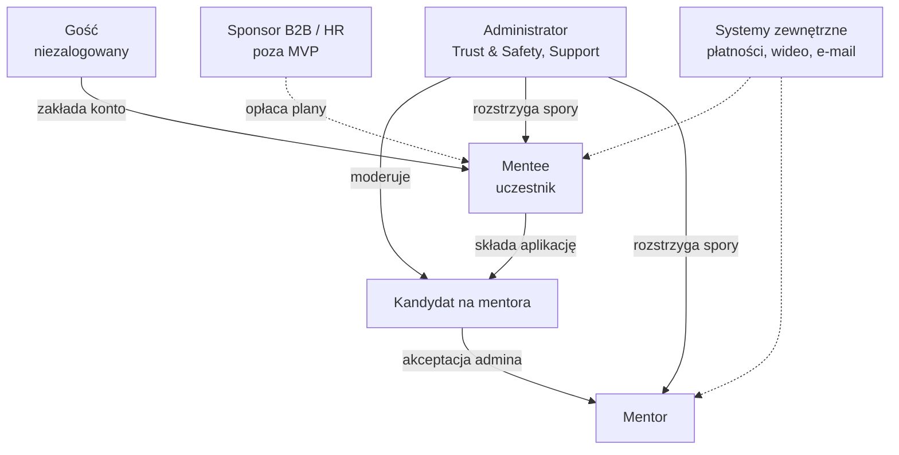

# 01 · Użytkownicy systemu i ich potrzeby

> [!NOTE]
> **Kontekst**
> **MentorHub** (nazwa robocza) to marketplace sesji mentoringowych 1:1 przez wideo: product, inżynieria, AI, UX, kariera. Benchmarkiem funkcjonalnym jest **Preply.com**: wyszukiwarka z filtrami, krótka lekcja próbna, plan tygodniowy na kredytach, wbudowany pokój wideo, ochrona płatności i kontaktu. Wygląd, teksty i kod są własne. Parametry biznesowe (ceny, progi godzinowe, prowizje) są **naszymi założeniami**, a nie danymi Preply.

## Mapa ról

## Role w skrócie

| Rola | Kim jest | Główny cel | Miara sukcesu |
|---|---|---|---|
| Gość | Osoba z wyszukiwarki lub polecenia | Ocenić, czy znajdzie tu właściwego mentora | Przejście do profilu i rezerwacja intro |
| Mentee | Specjalista 2–10 lat w zawodzie | Szybszy rozwój: awans, zmiana ścieżki, rozmowa rekrutacyjna | Intro → plan, regularne sesje, ocena 4–5★ |
| Mentor | Praktyk 5–20 lat, lider lub ekspert | Dzielić się wiedzą i dorobić na własnych warunkach | Wypełniony kalendarz, stały dochód, oceny |
| Administrator | Zespół operacyjny platformy | Jakość podaży, bezpieczeństwo, uczciwe spory | Czas decyzji, odsetek sporów, NPS |
| Systemy zewnętrzne | Bramka płatności, dostawca wideo, e-mail/push, KYC | Niezawodne transakcje i połączenia | Skuteczność płatności, jakość połączeń |

## Potrzeby, bóle i odpowiedź produktu

### Gość
- **Potrzeby:** szybko zobaczyć, kto jest dostępny w moim temacie, za ile i kiedy; zaufać, zanim zapłacę.
- **Bóle:** profile „z LinkedIna” bez dowodu jakości, brak cen, konieczność zakładania konta, żeby cokolwiek zobaczyć.
- **Odpowiedź produktu:**
  - publiczny katalog z filtrami i ceną na karcie (P2),
  - profil z wideo, opiniami i kalendarzem bez logowania (P3),
  - konto dopiero przy rezerwacji, przy czym wybór terminu nie przepada (M1 → P4 → M1),
  - tanie intro i gwarancja satysfakcji: następne intro u innego mentora gratis.

### Mentee
- **Potrzeby:**
  - konkretny efekt: awans, nowa rola, przygotowanie do rozmowy,
  - regularność,
  - elastyczne terminy,
  - pewność, że pieniądze nie przepadną.
- **Bóle:** trudno ocenić dopasowanie przed zakupem pakietu, sztywne pakiety, przepadające godziny, kontakt „poza platformą” bez ochrony.
- **Odpowiedź produktu:**
  - intro 30 min za połowę ceny 30-minutowej sesji (M1),
  - plan tygodniowy na kredytach, w którym zmienisz liczbę sesji, przeniesiesz kredyty do innego mentora albo anulujesz w każdej chwili (M8, M9),
  - darmowe przełożenie i anulowanie do 12 h przed sesją (M5),
  - pokój wideo ze wspólnymi notatkami (M6),
  - ocena i zgłoszenie problemu (M7, M5 → A3),
  - ochrona danych kontaktowych w wiadomościach (C1).

### Mentor
- **Potrzeby:** decydować o cenie i godzinach, mieć mało administracji, dostawać pieniądze na czas, mieć powtarzalnych podopiecznych.
- **Bóle:** fakturowanie, płatności i no-show, ciągłe uzgadnianie terminów mailem, brak widoczności.
- **Odpowiedź produktu:**
  - kreator aplikacji z zapisem szkicu (T1),
  - dostępność tygodniowa, urlopy i reguły rezerwacji (T3),
  - notatki i cele podopiecznych (T4),
  - zarobki z jawną prowizją malejącą z liczbą godzin, wypłaty z minimalną kwotą (T5),
  - profil z podglądem na żywo i moderacją zmian treści (T6).

### Administrator
- **Potrzeby:** wpuszczać tylko jakościowych mentorów, szybko i uczciwie rozwiązywać spory, widzieć zdrowie marketplace’u.
- **Bóle:** ręczna weryfikacja, brak dowodów w sporach („mentor nie przyszedł”), brak audytu decyzji.
- **Odpowiedź produktu:**
  - kolejka aplikacji z kontrolami KYC/LinkedIn/wideo i decyzją z uzasadnieniem (A2),
  - spory z osią czasu z logów pokoju wideo (A3),
  - KPI w jednym widoku: GMV, sesje, konwersja intro → plan (A1).

### Systemy zewnętrzne (aktorzy techniczni)
- **Bramka płatności (PCI-DSS):** płatność kartą lub BLIK, karty zapisane jako tokeny, płatności cykliczne planów, zwroty.
- **Dostawca wideo (WebRTC):** tokeny pokoju, logi wejścia i wyjścia, które są dowodem w sporach.
- **E-mail i push:** potwierdzenia, przypomnienia 24 h i 1 h przed sesją, powiadomienia.
- **KYC:** weryfikacja tożsamości mentora.

> [!WARNING]
> **Poza MVP, ale zapisane świadomie**
> - **Sponsor B2B / HR:** firma opłaca plany pracownikom, ma budżet, raporty i fakturę zbiorczą. To odpowiednik Preply Business. Dochodzą wtedy role „Company admin” i „Pracownik z budżetem”.
> - Sesje grupowe, materiały i kursy, aplikacja mobilna natywna, 2FA (w MVP tylko przycisk).

## Persony robocze (dane demo w makietach)

| Persona | Rola | Sytuacja | Czego oczekuje |
|---|---|---|---|
| Kasia Nowak | Mentee | PM, chce awansu na Senior PM; ma plan 1×/tydz. z Markiem | Feedback do roadmapy, przygotowanie do rozmowy |
| Anna Wiśniewska | Mentor | Head of Product, 12 lat, Super mentor | Stali podopieczni wieczorami, mało administracji |
| Ops Admin | Administrator | Zespół Trust & Safety | Kolejka aplikacji i sporów pod kontrolą |

> [!TIP]
> **Jak przełączać role w makiecie**
> Ciemny pasek na dole makiety ma pole **Role** (Guest / Mentee / Mentor / Admin) i **Data state** (Live / Loading / Empty / Error). Pełna lista ekranów jest pod przyciskiem **Screen map** (`#/map`).
