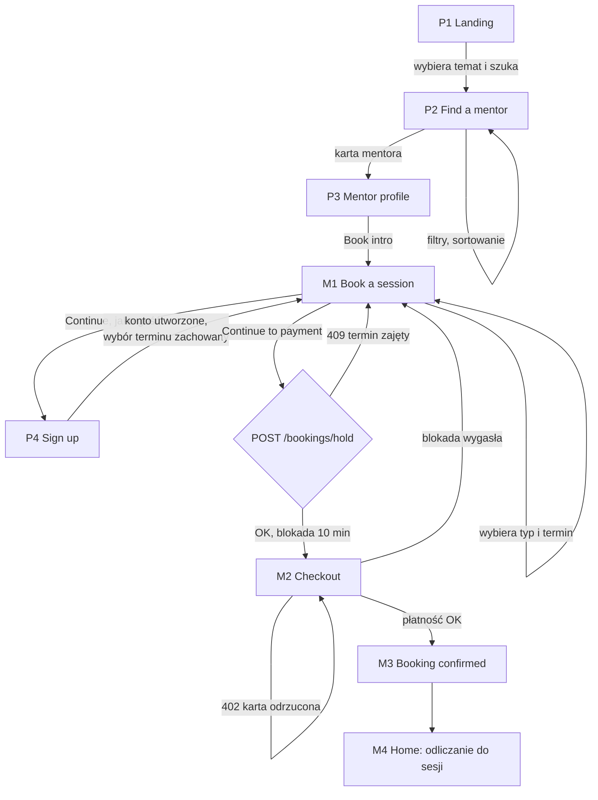
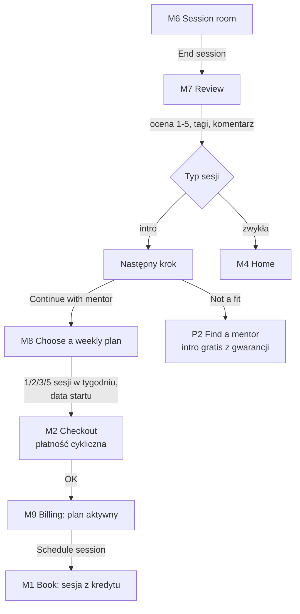
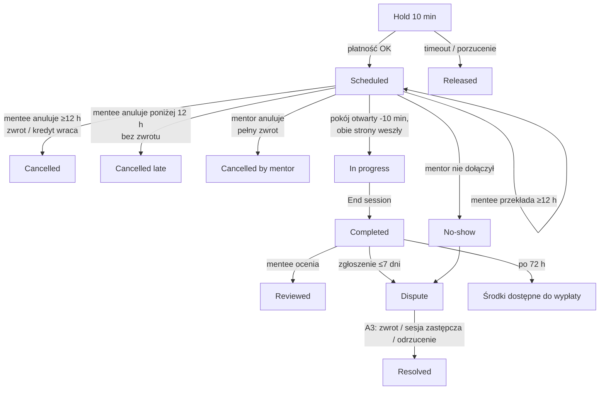
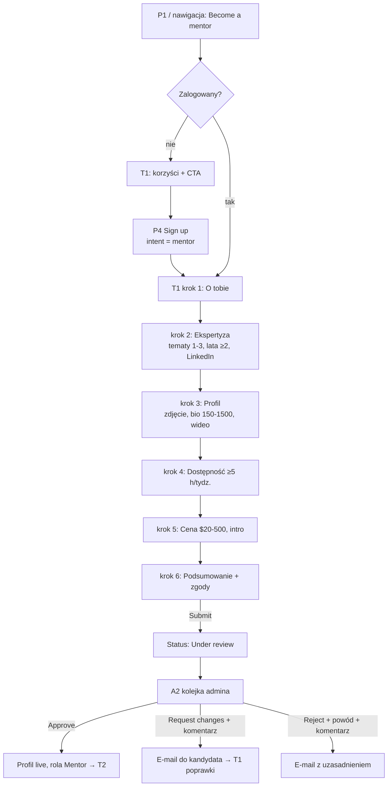
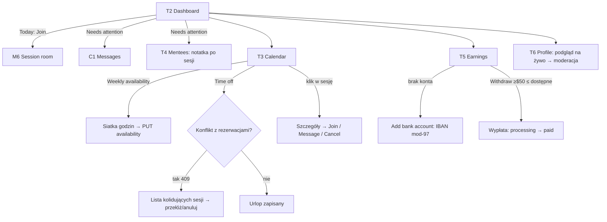
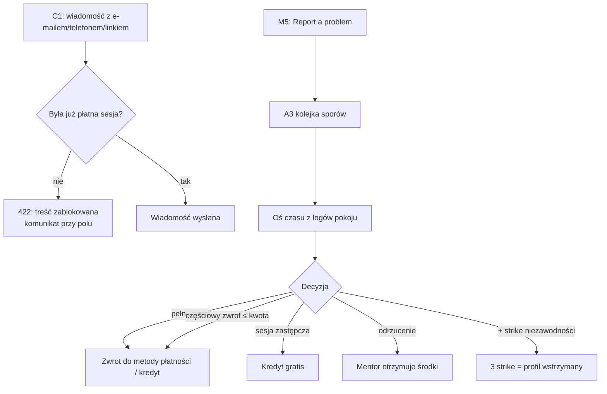

# 02 · Najważniejsze use case'y i kompletne przepływy

Identyfikatory ekranów (P*, M*, C*, T*, A*) odpowiadają [03-Mapa-ekranow-i-nawigacja](03-Mapa-ekranow-i-nawigacja.md) i makietom (ID widać na dolnym pasku makiety).

## Katalog use case'ów

| ID | Use case | Aktor | Ekrany | Priorytet |
|---|---|---|---|---|
| UC-01 | Znajdź i oceń mentora | Gość, Mentee | P1, P2, P3 | MVP |
| UC-02 | Zarezerwuj sesję intro (pierwsza wizyta) | Gość → Mentee | P3, M1, P4, M2, M3 | MVP |
| UC-03 | Zarezerwuj pojedynczą sesję | Mentee | P3, M1, M2, M3 | MVP |
| UC-04 | Wykup plan tygodniowy po intro | Mentee | M7, M8, M2, M9 | MVP |
| UC-05 | Przełóż lub anuluj sesję | Mentee | M5 | MVP |
| UC-06 | Odbądź sesję w pokoju wideo | Mentee, Mentor | M6 | MVP |
| UC-07 | Oceń sesję / zgłoś problem | Mentee | M7, M5 | MVP |
| UC-08 | Napisz do mentora / mentee | Mentee, Mentor | C1 | MVP |
| UC-09 | Zarządzaj planami, kredytami, kartami i fakturami | Mentee | M9 | MVP |
| UC-10 | Zarządzaj kontem, powiadomieniami, RODO | Wszyscy zalogowani | C2, C3 | MVP |
| UC-11 | Złóż aplikację mentora | Mentee | T1 | MVP |
| UC-12 | Ustaw dostępność, urlop i reguły | Mentor | T3 | MVP |
| UC-13 | Prowadź podopiecznych (cele, notatki) | Mentor | T4 | MVP |
| UC-14 | Anuluj sesję jako mentor | Mentor | T3 | MVP |
| UC-15 | Wypłać zarobki | Mentor | T5 | MVP |
| UC-16 | Edytuj profil publiczny | Mentor | T6 | MVP |
| UC-17 | Rozpatrz aplikację mentora | Admin | A2 | MVP |
| UC-18 | Rozstrzygnij spór | Admin | A3 | MVP |
| UC-19 | Monitoruj marketplace | Admin | A1 | MVP |
| UC-20 | Procesy systemowe: przypomnienia, odnowienia, blokady, zwolnienie środków | System | — | MVP |
| UC-21 | Plany opłacane przez firmę (B2B) | Sponsor HR | — | po MVP |

## Reguły biznesowe (parametry konfigurowalne)

Wartości poniżej to **założenia startowe**. W kodzie makiety zebrano je w obiekcie `RULES` w `mockups/src/data.ts`.

| Reguła | Wartość startowa | Gdzie działa |
|---|---|---|
| Sesja intro | 30 min, połowa ceny 30-minutowej sesji, raz na parę mentee–mentor | M1, M2 |
| Gwarancja satysfakcji | Jeśli intro nie pasuje, następne intro u innego mentora gratis | M7, A3 |
| Minimalne wyprzedzenie rezerwacji | 4 h (mentor może ustawić 1–48 h) | M1, T3 |
| Blokada terminu na czas płatności | 10 min, potem termin wraca do puli | M1 → M2 |
| Darmowe przełożenie / anulowanie | Do 12 h przed sesją; później kredyt lub płatność przepada, mentor dostaje wynagrodzenie | M5 |
| Anulowanie przez mentora | Zawsze pełny zwrot dla mentee; poniżej 24 h obniża wskaźnik niezawodności | T3, A3 |
| Pokój wideo | Otwiera się 10 min przed startem | M6 |
| Plan tygodniowy | 1/2/3/5 sesji tygodniowo, rozliczenie co 4 tygodnie, auto-odnowienie, anulowanie w każdej chwili | M8, M9 |
| Niewykorzystane kredyty | Przechodzą na kolejny cykl jeden raz; po anulowaniu planu ważne do końca cyklu | M9 |
| Przeniesienie kredytów | Do innego mentora, przeliczone wartościowo | M9 |
| Opłata serwisowa | $1,50 za transakcję | M2 |
| Prowizja platformy | 25% → 20% od 50 h → 15% od 200 h przepracowanych; z intro platforma zatrzymuje całość | T5 |
| Zwolnienie środków mentora | 72 h po sesji (okno na reklamację) | T5 |
| Minimalna wypłata | $50 | T5 |
| Ochrona kontaktu | Blokada e-maili, telefonów i linków w wiadomościach do pierwszej odbytej płatnej sesji | C1 |
| Zgłoszenie problemu | Do 7 dni po sesji; pierwsza odpowiedź do 24 h | M5, A3 |
| Moderacja profilu | Zmiany nagłówka, bio i wideo idą do akceptacji (ok. 24 h); cena i tematy od razu | T6 |
| Decyzja o aplikacji | Do 5 dni roboczych; odrzucenie i prośba o zmiany wymagają uzasadnienia | A2 |

> [!IMPORTANT]
> **Do decyzji przed PRD**
> 1. Waluta i podatki: USD w makiecie; czy PLN/EUR i VAT OSS?
> 2. Czy intro ma być płatne (jak w makiecie), czy darmowe 15 min (inny lejek, wyższe ryzyko no-show)?
> 3. Model prowizji: progresywny (jak w makiecie) czy stały procent?
> 4. Kto wystawia fakturę mentee: platforma (model agencyjny) czy mentor (marketplace)?

---

## Przepływ F1 · Gość → pierwsza sesja intro (UC-01, UC-02)

**Kroki główne**
1. Gość wybiera temat na P1 albo od razu przegląda katalog P2.
2. Na P2 zawęża listę filtrami (temat, cena, pora dnia, język, Super mentor) i sortuje.
3. Na P3 ogląda wideo, opinie i kalendarz, potem klika „Book intro”.
4. Na M1 wybiera typ sesji i termin oraz opcjonalnie wpisuje cel spotkania.
5. Jako gość zostaje przekierowany do P4 (rejestracja). Po założeniu konta wraca na M1 z zachowanym terminem (parametry `next` i `slot`).
6. „Continue to payment” blokuje termin na 10 min (`POST /api/bookings/hold`).
7. Na M2 wybiera kartę zapisaną, nową albo BLIK, opcjonalnie wpisuje kod promocyjny i płaci.
8. M3 pokazuje potwierdzenie, przycisk „Dodaj do kalendarza” (.ics), wiadomość do mentora i następne kroki.

**Ścieżki alternatywne i błędy**
- **Brak wyników na P2:** pusty stan z „Clear all filters”.
- **Mentor nie oferuje intro albo intro już wykorzystane:** M1 pokazuje tylko sesje płatne i wyjaśnienie.
- **Brak wolnych terminów w tygodniu:** pusty stan z „Next week” i „Message mentor”.
- **409 przy blokadzie:** ktoś właśnie zarezerwował termin. Komunikat w miejscu, siatka terminów odświeża się sama.
- **402 przy płatności:** karta odrzucona albo BLIK wygasł. Komunikat nad formularzem, dane zostają w polach.
- **Blokada wygasła:** M2 przechodzi w stan błędu z przyciskiem „Pick another time”.
- **Zły kod promocyjny:** błąd przy polu, suma bez zmian.

## Przepływ F2 · Po intro → plan tygodniowy (UC-04, UC-07, UC-09)

**Kroki główne**
1. Po sesji mentee trafia na M7. Ocena jest wymagana; przy 1–3★ wymagany jest też komentarz (min. 20 znaków).
2. Po ocenie intro widzi dwie drogi: „Continue with mentor” (M8) albo „Find another mentor” (gwarancja).
3. Na M8 wybiera liczbę sesji w tygodniu i datę startu (od dziś do 30 dni). Widzi cenę za 4 tygodnie.
4. Płatność cykliczna na M2 (koszyk typu `subscription`).
5. M9 pokazuje aktywny plan, kredyty i datę odnowienia. Sesje rezerwuje się z kredytów na M1.

**Alternatywy:**
- **Mentor nie ma planów:** pusty stan z rezerwacją pojedynczej sesji.
- **Zmiana planu (M9):** obowiązuje od następnego cyklu.
- **Anulowanie planu:** wymaga powodu; plan się nie odnawia, kredyty działają do końca cyklu.
- **Przeniesienie kredytów:** wybór mentora i liczby kredytów nie większej niż saldo; 422 przy przekroczeniu.

## Przepływ F3 · Cykl życia sesji (UC-05, UC-06, UC-07, UC-14, UC-18)

**Szczegóły kroków**
- **Przełożenie (M5):** modal z dostępnymi terminami tego mentora. Poniżej 12 h modal wyjaśnia regułę i proponuje wiadomość do mentora.
- **Anulowanie (M5):** powód jest wymagany. Komunikat zależy od czasu: zielony przy zwrocie, pomarańczowy przy jego braku.
- **Pokój (M6):**
  - przed czasem widać baner „Room opens 10 min before”,
  - ekran przed wejściem: kamera, mikrofon, poziom dźwięku,
  - w trakcie: licznik, wycisz, kamera, udostępnij ekran, notatki z autozapisem, czat i agenda,
  - „End session” wymaga potwierdzenia.
- **Zgłoszenie problemu (M5, sesje przeszłe):** kategoria i opis min. 20 znaków. Zgłoszenie trafia do A3 z osią czasu z logów pokoju.

## Przepływ F4 · Zostań mentorem → akceptacja (UC-11, UC-17)

- Każdy krok zapisuje szkic (`PATCH /api/mentor-applications/{id}`); „Save & exit” wraca później do tego samego kroku.
- Na kroku 6 każda sekcja ma „Edit”, który wraca do odpowiedniego kroku.
- **Decyzja admina (A2):** 409, jeśli inny admin zdecydował wcześniej. Każda decyzja ma autora i znacznik czasu (audyt).

## Przepływ F5 · Codzienna praca mentora (UC-12, UC-13, UC-15, UC-16)

## Przepływ F6 · Bezpieczeństwo i spory (UC-08, UC-18)

## Procesy systemowe (UC-20) — bez ekranu, ale z konsekwencjami w UI

| Proces | Wyzwalacz | Efekt widoczny w UI |
|---|---|---|
| Zwolnienie blokady terminu | 10 min bez płatności | M2 „Your hold has expired” |
| Przypomnienia | 24 h i 1 h przed sesją | e-mail, push, C2 |
| Auto-odnowienie planu | co 4 tygodnie | faktura w M9, powiadomienie C2; nieudane obciążenie = plan wstrzymany i baner |
| Zwolnienie środków mentora | 72 h po sesji bez sporu | T5: Pending → Available |
| Oznaczenie no-show | mentor nie wszedł w ciągu 15 min | automatyczny spór w A3 |
| Prośba o ocenę | koniec sesji | M4 „To do”, C2 |
