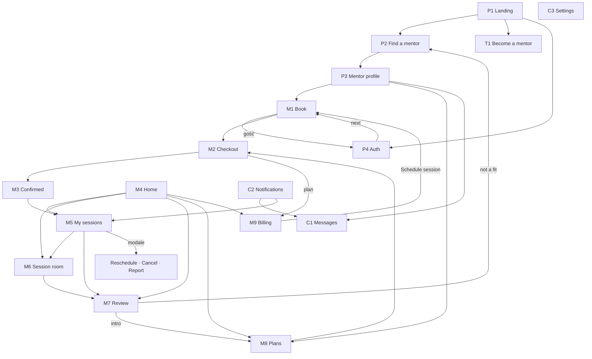
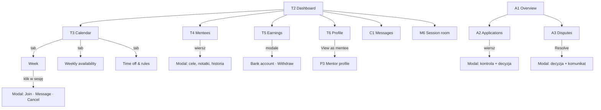

# 03 · Mapa ekranów i nawigacji

26 ekranów w 5 grupach. Każdy ma ID, adres w makiecie (routing hash, `#/…`) i listę ról, które go widzą. Ekran P0 istnieje tylko w prototypie: to indeks wszystkich ekranów z przyciskiem „Open as…”.

## Inwentarz ekranów

| ID | Ekran (nazwa w UI) | Adres | Role |
|---|---|---|---|
| P0 | Screen map (tylko prototyp) | `#/map` | wszyscy |
| P1 | Landing page | `#/` | wszyscy |
| P2 | Find a mentor | `#/mentors` | wszyscy |
| P3 | Mentor profile | `#/mentors/:id` | wszyscy |
| P4 | Sign up / Log in / Forgot password | `#/auth?mode=` | gość |
| M1 | Book a session | `#/book/:mentorId` | wszyscy (płatność wymaga konta) |
| M2 | Checkout | `#/checkout` | mentee |
| M3 | Booking confirmed | `#/booking/:id/confirmed` | mentee |
| M4 | Home (pulpit mentee) | `#/home` | mentee |
| M5 | My sessions | `#/sessions?tab=` | mentee |
| M6 | Session room | `#/room/:id` | mentee, mentor |
| M7 | Review a session | `#/sessions/:id/review` | mentee |
| M8 | Choose a weekly plan | `#/plans/:mentorId` | mentee |
| M9 | Billing & plans | `#/billing` | mentee |
| C1 | Messages | `#/messages/:id?` | mentee, mentor |
| C2 | Notifications | `#/notifications` | zalogowani |
| C3 | Account settings | `#/settings?tab=` | zalogowani |
| T1 | Become a mentor (kreator 6 kroków) | `#/apply` | gość (CTA), mentee |
| T2 | Mentor dashboard | `#/mentor` | mentor |
| T3 | Calendar & availability | `#/mentor/calendar?tab=` | mentor |
| T4 | My mentees | `#/mentor/mentees` | mentor |
| T5 | Earnings & payouts | `#/mentor/earnings` | mentor |
| T6 | Public profile (edytor) | `#/mentor/profile` | mentor |
| A1 | Admin overview | `#/admin` | admin |
| A2 | Mentor applications | `#/admin/applications?status=` | admin |
| A3 | Disputes & reports | `#/admin/disputes?status=` | admin |

## Nawigacja globalna według roli

| Rola | Menu główne (górny pasek) | Prawa strona paska |
|---|---|---|
| Gość | Find a mentor · Become a mentor · How it works | Log in · Sign up |
| Mentee | Home · Find a mentor · My sessions · Messages · Billing | 🔔 (C2) · avatar (C3) · Log out |
| Mentor | Dashboard · Calendar · Mentees · Messages · Earnings · Profile | 🔔 (C2) · avatar (C3) · Log out |
| Admin | Overview · Applications · Disputes | 🔔 (C2) · avatar (C3) · Log out |

**Reguły nawigacji**
- **Logo** prowadzi do ekranu startowego roli: gość P1, mentee M4, mentor T2, admin A1.
- **Strażnik roli:**
  - gość na ekranie wymagającym konta widzi „Please log in to continue” z przyciskami do P4, a parametr `next` prowadzi z powrotem po zalogowaniu,
  - zalogowany w złej roli dostaje 403; w produkcji przekierowanie na swój ekran startowy, w prototypie przycisk zmiany roli.
- **Głębokie linki z powiadomień (C2)** prowadzą wprost do obiektu: wątek C1, sesje M5, recenzja M7, zarobki T5, kolejki A2 i A3.
- **Telefon (≤ 760 px):** menu przewija się poziomo pod logo; układy dwukolumnowe składają się do jednej kolumny, a siatka terminów przewija się w poziomie wewnątrz karty.

## Mapa nawigacji — gość i mentee

## Mapa nawigacji — mentor i admin

## Wzorce wspólne dla wszystkich ekranów

| Wzorzec | Zachowanie |
|---|---|
| Ładowanie | Szkielety kart i linii (`aria-busy`) w miejscu przyszłej treści, nigdy pusty ekran |
| Pusto | Ilustracja, tytuł, jedno zdanie „dlaczego”, jedno główne CTA |
| Błąd | Komunikat po ludzku, przycisk „Try again” ponawiający tylko ten fragment; błędy formularzy przy polach, błąd ogólny nad formularzem |
| Sukces | Toast (3,8 s) przy drobnych akcjach; pełny stan sukcesu przy zakończeniu ścieżki (M3, T1, M7, reset hasła) |
| Akcje destrukcyjne | Modal z konsekwencją (zwrot / brak zwrotu), wymagany powód, przycisk w kolorze błędu |
| Przyciski w trakcie wysyłki | Spinner, blokada podwójnego kliknięcia |
| Czas | Zawsze w strefie użytkownika, z nazwą strefy przy wyborze terminu |
| Dostępność | Etykiety pól, `aria-invalid`, `role=alert` dla błędów, focus na pierwszym błędnym polu, Esc zamyka modal |
